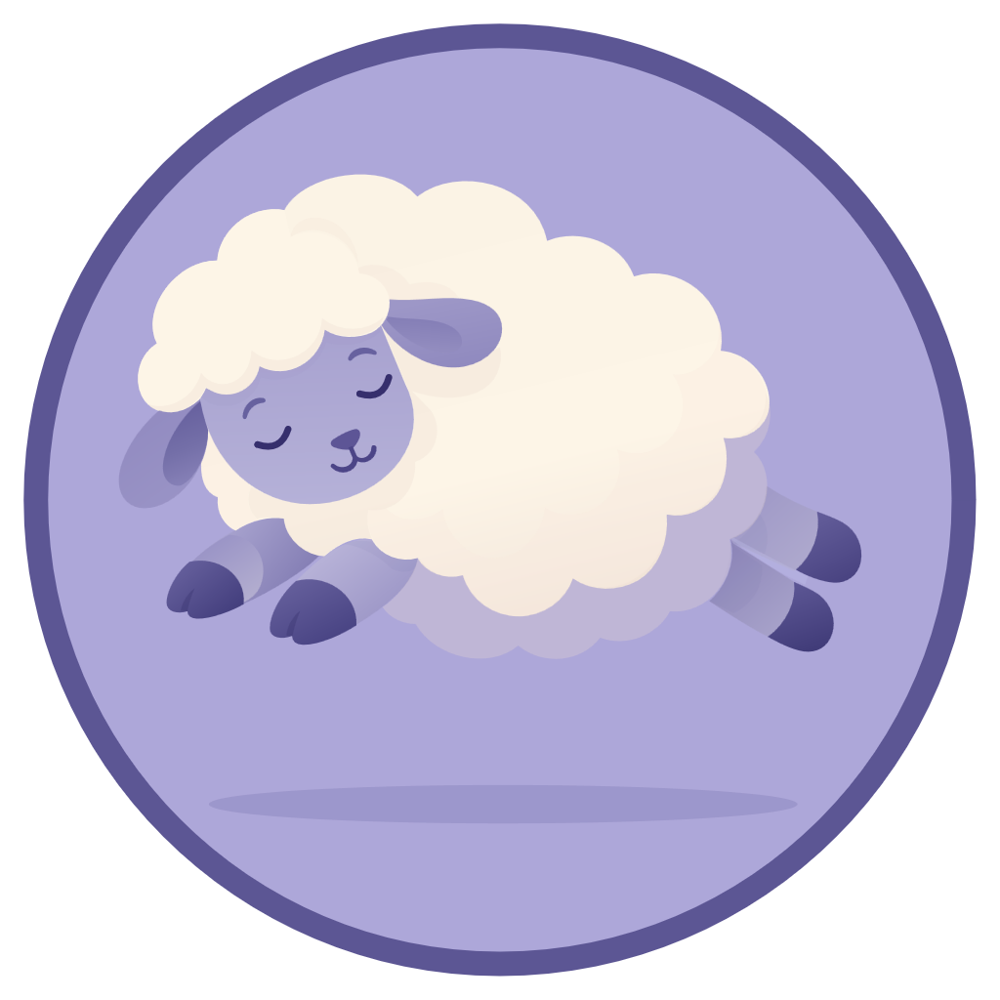
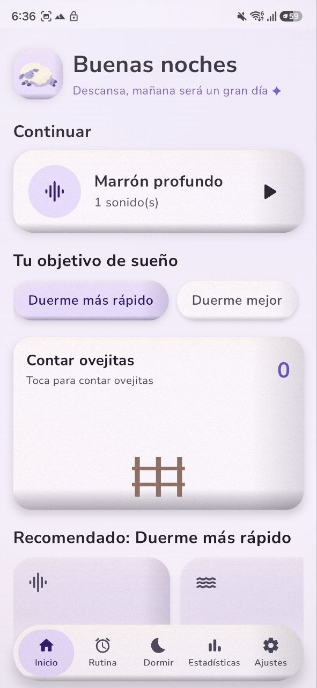
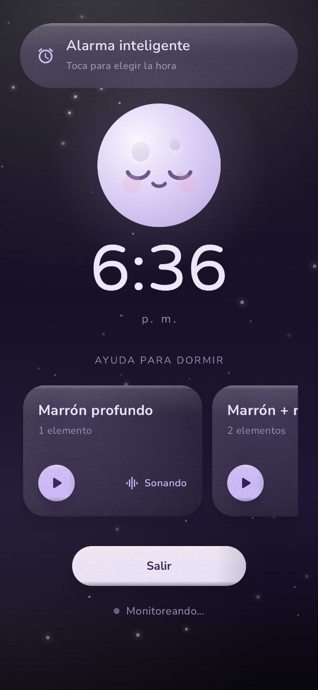
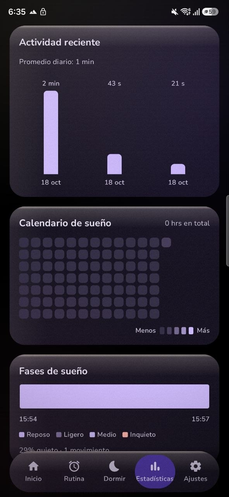

<div align="center">



# Sheepsleep

**Monitoreo del sueño y relajación para Android. Gratis, de código abierto y 100 % local.**

Sin cuentas · Sin nube · Sin servicios de Google


</div>

---

## Contenido

- [Características](#características)
- [Privacidad](#privacidad)
- [Capturas de pantalla](#capturas-de-pantalla)
- [Compilar](#compilar)
- [Sonidos](#sonidos)
- [Pruebas](#pruebas)
- [Publicar una versión](#publicar-una-versión)
- [Tipografía](#tipografía)
- [Contribuir](#contribuir)
- [Licencia](#licencia)

## Características

| Área | Qué ofrece |
| --- | --- |
| 🎧 **Mezclas** | Capas de ruido con volumen independiente (pestañas *Inicio*, *Rutina* y *Crear mezcla*). Cada capa usa su propio `ExoPlayer` dentro de un servicio en segundo plano con notificación. |
| 🌙 **Dormir** | Al empezar la noche se abre un salvapantallas con reloj, luna y tus mezclas. Mantiene la pantalla encendida y oculta las barras del sistema. |
| 🐑 **Ovejitas** | Contador de ovejitas para conciliar el sueño: la oveja salta de derecha a la izquierda de la tarjeta y el número se anima al sumar. |
| 📊 **Estadísticas** | Noches registradas, gráfico de actividad reciente, calendario de sueño e hipnograma. |
| 🎙️ **Ronquidos y movimiento** | Grabación de ronquidos activada por volumen y monitor de movimiento durante la noche. |
| ⏰ **Despertador** | Alarma integrada con alarma exacta. |
| 📤 **Tus datos** | Exportación en CSV o JSON y borrado total desde Ajustes. |

## Privacidad

Todo se queda en tu dispositivo:

- Las sesiones, el movimiento y el audio de los ronquidos viven en el sandbox de la app.
- No se sube nada a ningún servidor.
- Puedes exportarlos (CSV/JSON) o borrarlos por completo en **Ajustes → Tus datos de sueño**.

La única conexión externa es la comprobación de actualizaciones contra GitHub Releases (ver [Publicar una versión](#publicar-una-versión)).

## Capturas de pantalla

| Inicio | Modo noche | Estadísticas |
| :---: | :---: | :---: |
|  |  |  |
| Mezclas, objetivo de sueño y ovejitas | Reloj, luna y tus mezclas | Actividad, calendario y fases |

## Compilar

**Requisitos**

- Android Studio Ladybug o superior
- JDK 17
- `compileSdk 37` · `minSdk 26`

**Pasos**

1. Abre la carpeta del proyecto en Android Studio.
2. Ejecuta el módulo `app`, o desde la terminal:

```bash
./gradlew :app:assembleDebug     # APK de depuración
./gradlew :app:assembleRelease   # APK de release (sin firmar por defecto)
```

Para firmar el APK de release con tu propio keystore, sigue [docs/FIRMA.md](docs/FIRMA.md). Si no existe `keystore.properties`, el build genera un APK sin firmar en lugar de fallar.

## Sonidos

Incluye ruido **blanco**, **rosa** y **marrón**, generados por código, por lo que no tienen licencia que atribuir.

### Añadir más sonidos

Copia el archivo a `app/src/main/res/raw/` con uno de estos nombres (en minúsculas):

`rain` · `waves` · `wind` · `fire` · `forest`

Formatos admitidos: `.ogg`, `.wav`, `.flac`.

Recomendaciones:

- Usa material CC0 o compatible con la licencia del proyecto, y anota la atribución.
- Para bucles sin cortes, usa archivos preparados para loop.

Los sonidos que importa el usuario se guardan en `filesDir/custom_audio`.

> [!NOTE]
> `res/raw/keep.xml` mantiene los `.wav` en el APK de release. El catálogo resuelve los sonidos por nombre con `getIdentifier()`, una referencia que R8 no puede ver.

## Pruebas

```bash
./gradlew :app:testDebugUnitTest
```

Son 46 pruebas centradas en lo que puede afectar al usuario:

| Archivo | Qué comprueba |
| --- | --- |
| `VersionComparatorTest` | Detección de versiones nuevas; un prelanzamiento (`1.0.0-beta`) no se ofrece sobre la estable. |
| `HashVerifiedDownloadTest` | Un SHA-256 incorrecto no publica el archivo ni deja restos. |
| `CatalogValidationTest` | Las entradas inválidas del catálogo (rutas, extensiones, hashes) se descartan. |
| `ClipRetentionTest` | La retención configurada se persiste y acota; el corte de limpieza la respeta. |
| `SoundCatalogTest` | Los sonidos sin archivo no aparecen en la lista y todo lo listado se puede reproducir. |
| `SnoreDetectorTest` | El silencio no dispara grabaciones, un pico aislado tampoco y un sonido sostenido abre y cierra el clip. |

## Publicar una versión

`AppUpdateChecker` consulta GitHub Releases del repositorio [Eion21/Sheepsleep](https://github.com/Eion21/Sheepsleep).

1. Sube `versionCode` y `versionName` en `app/build.gradle.kts`.
2. Compila y firma el APK de release.
3. Crea la release en GitHub con la etiqueta `vX.Y.Z` y adjunta el APK.

## Tipografía

- **Nunito Sans**: cuerpo de texto
- **Varela Round**: títulos

Ambas están empaquetadas en `app/src/main/res/font/` y se distribuyen bajo SIL Open Font License 1.1 (ver [OFL.txt](OFL.txt)).

## Contribuir

¡Las contribuciones son bienvenidas! Abre un *issue* para reportar errores o proponer ideas, o envía un *pull request*. Antes de hacerlo, ejecuta las pruebas:

```bash
./gradlew :app:testDebugUnitTest
```

## Licencia

Distribuido bajo licencia MIT. Consulta [LICENSE](LICENSE).
